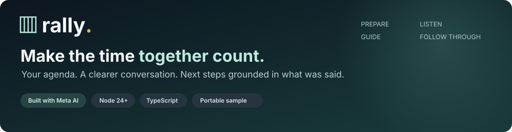
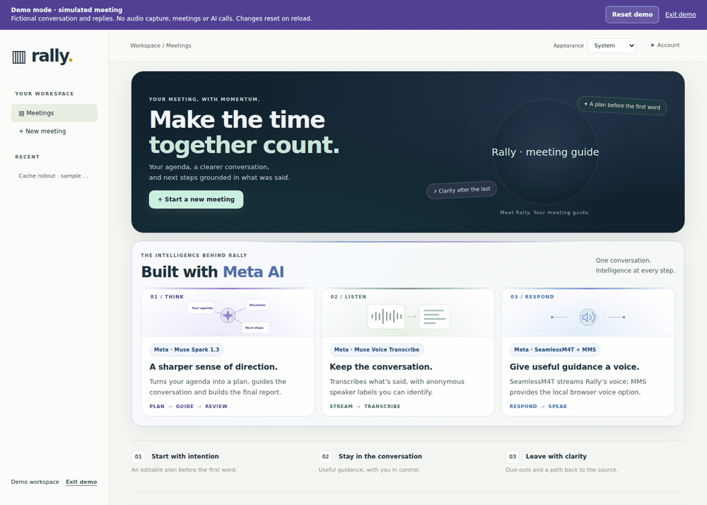
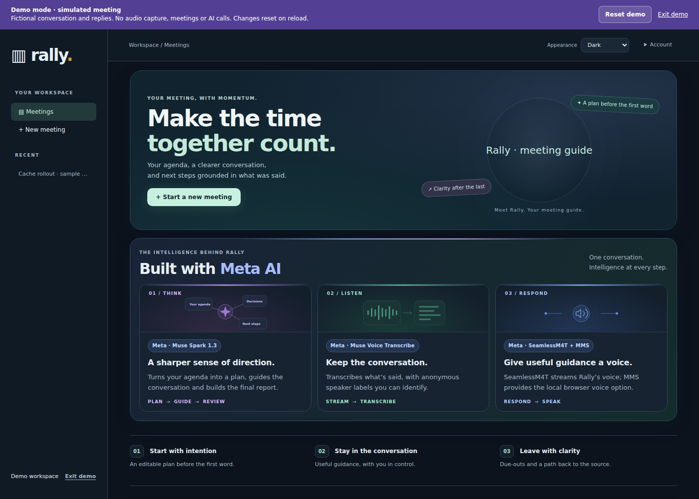
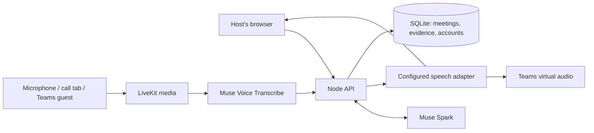

<p align="center">
  
</p>

<p align="center">
  <a href="https://rally.tail703f9e.ts.net/demo.html"><strong>Try Rally</strong></a> ·
  <a href="#quick-start">Quick start</a> ·
  <a href="docs/judge-quickstart.md">Use your own API key</a> ·
  <a href="docs/README.md">Documentation</a> ·
  <a href="CONTRIBUTING.md">Contribute</a>
</p>

**Leave the meeting knowing what you decided, who owns the work, and what is still open.**

Rally is an AI meeting facilitator built around Meta models. Give it your agenda, choose how involved it should be, and let it follow the conversation. It can offer guidance while you meet, then turn the transcript into decisions, action items and a report you can trace back to what was said.

<p align="center"></p>

*An edited tour of the simulated workspace, using fictional participants and sample text. Cuts and holds shorten the walkthrough; this GIF does not show live inference or model latency.*

<details>
<summary>Prefer a still image?</summary>



</details>

## What you can do

| Before the call | During the conversation | After the meeting |
| --- | --- | --- |
| Turn an agenda into an editable plan | Follow streaming transcription | Review decisions, actions and open questions |
| Set the time available and desired outcomes | Ask Rally a question or receive timely guidance | Jump from report claims to source excerpts |
| Choose passive, balanced or proactive participation | Pause, dismiss or mute Rally; identify speakers | Add notes, export PDF/JSON and share with Rally users |

Rally keeps **unconfirmed owners, dates and decisions visibly unresolved**. You control its participation. Its animated meeting presence reflects agenda guidance—not participant emotion or personality.

## Quick start

### Explore in your browser

**[Open the interactive demo →](https://rally.tail703f9e.ts.net/demo.html)**

No login, API key or microphone needed. Create a meeting, watch a fictional engineering discussion stream in with prerecorded Meta voices, ask Rally a scripted question, then inspect a sample report. A completed meeting in history offers the full evidence trail immediately.

### Run the sample locally

```sh
git clone https://github.com/ejo4041/Rally.git
cd Rally
python3 -m http.server 8000 --bind 127.0.0.1 --directory demo
```

Open **http://127.0.0.1:8000/**. Python 3 is the only prerequisite. No package install, backend or model download is required. While this repository is private, cloning requires an account with repository access.

### Connect real models with your own key

Follow the **[full local setup guide](docs/judge-quickstart.md)** for Node 24, locked dependencies, local LiveKit, private configuration and administrator activation with MFA. Enable your own Meta Model API key only when you are ready for paid processing.

Start with **browser microphone or tab capture**. Spoken replies and a guest Teams participant require additional model/media provisioning; they are optional setup paths. No Azure ACS resource or app registration is needed for the implemented guest-client Teams route.

| Evaluation path | Models and data | Requirements |
| --- | --- | --- |
| Hosted or local sample | Fictional text and prerecorded voices; no live model calls | Browser; Python 3 for local serving |
| Full app: browser capture | Real reasoning and transcription using your key | Node 24+, dependencies, LiveKit, invited account/MFA and model access |
| Full app: speech / Teams guest | Real meeting participant and configured speech adapter | Additional Linux browser, virtual media and model/service provisioning |

The sample shares the real app's interface but uses an isolated in-memory simulator. It cannot access private meetings. Reload resets its meeting edits; report sharing is simulated. The full app retains invitation-only accounts and MFA.

## Built with Meta AI

| Technology | What it does |
| --- | --- |
| **Muse Spark 1.3** | Prepares the plan, evaluates the conversation and builds the final report |
| **Muse Voice Transcribe** | Streams transcription and anonymous speaker labels; Rally does not rely on native Teams transcripts |
| **SeamlessM4T** | Provides the deployed streamed voice through a configured hosted endpoint |
| **Meta MMS** | Supplies an optional local voice and prerecorded sample participants |
| **Meta FastSpeech2 + HiFi-GAN** | Supplies another prerecorded sample voice; not the default production adapter |

[Model interfaces and configuration](docs/model-interfaces.md) · [Speech provisioning](experiments/meta-mms/README.md) · [Model and component attribution](THIRD_PARTY_NOTICES.md)

## How it fits together



The host chooses when to capture, speak and stop. Reports cite finalized transcript evidence. Keys stay server-side. **[Architecture and source map →](docs/architecture-overview.md)**

## Develop Rally

The current app is in `apps/rally-api/` and `apps/rally-web/`. After following the local setup guide:

```sh
node scripts/dev-rally.mjs
```

The workspace opens at http://127.0.0.1:5173/. Model processing defaults off. To check a change:

```sh
npm run typecheck --prefix apps/rally-api
npm test --prefix apps/rally-api
npm run typecheck --prefix apps/rally-web
npm test --prefix apps/rally-web
npm run build --prefix apps/rally-web
python3 scripts/check-repo-docs.py
```

The ordinary unit suites use fixtures and do not need a model key. Browser and media integration checks have separate prerequisites. See [contributing](CONTRIBUTING.md) for branch conventions, validation and useful bug reports.

## Current scope

Rally is a hackathon prototype with real Teams/browser capture, Meta model integration and report workflows. The source also includes a portable simulated sample for evaluation without service access. **[Implemented capabilities and limits](docs/capabilities.md)** explains the distinction.

WhatsApp follow-up is a reviewed manual draft; link-based WhatsApp joining remains experimental. Anonymous speaker labels need human identification. Meeting summaries are model interpretations for review. Local setup and optional integrations have different requirements; check the [tested setup boundaries](docs/judge-setup-verification-2026-11-03.md).

## Explore further

- **Use it:** [local setup](docs/judge-quickstart.md), [capabilities](docs/capabilities.md), [common questions](docs/faq.md).
- **Build on it:** [architecture](docs/architecture-overview.md), [API contract](docs/backend-api.md), [contributing](CONTRIBUTING.md).
- **Understand the sample:** [provenance](demo/provenance.json), [voice assets](demo/demo-audio/README.md), [demo isolation](docs/judge-access-rehearsal.md).
- **Report a problem:** [bug report](https://github.com/ejo4041/Rally/issues/new?template=bug_report.yml), [security guidance](SECURITY.md).

Rally's original application code and documentation are licensed under the [MIT License](LICENSE). The scope and third-party exclusions are explained in [licensing](docs/licensing.md). Models, libraries and supplied visual artwork retain their own rights and attribution; see [component notices](THIRD_PARTY_NOTICES.md) and the [maintainer release checklist](docs/source-release-readiness.md).
