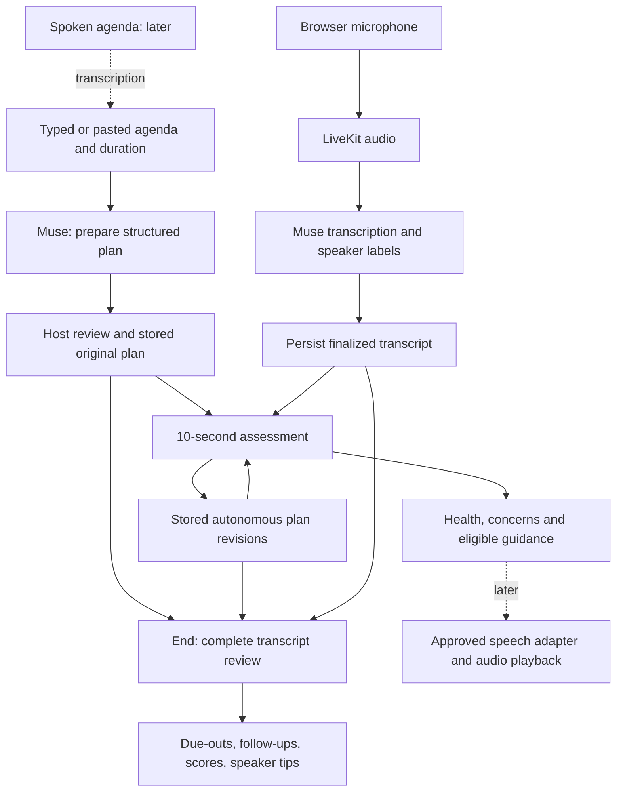

# Rally AI processing — MVP overview

This document describes the new Node backend. It is a starting point for prompt tuning, not a claim of calibrated meeting-quality measurement. [Implementation plan](backend-plan.md) · [API](backend-api.md) · [model contracts](model-interfaces.md).

## Stage contracts

| Stage | Inputs | Outputs | Rules |
| --- | --- | --- | --- |
| Agenda preparation | Source agenda/objective, duration, optional names | Objective, topics, intended outcomes, time budgets, wrap-up | Preserve user intent and total duration; infer structure, not organizational facts. Host reviews before recording. |
| Transcription | Mono 16 kHz PCM through LiveKit | Cumulative partial captions; finalized turns with session/turn IDs, speaker and timing | Only finalized turns are evidence. Unknown/overlapping attribution stays unknown. Separate Muse speaker events are normalized in the adapter. |
| Live assessment | Current plan, elapsed time, cumulative progress, latest 40 finalized turns, previous interventions | 0–5 health, concerns, evidence, progress, optional intervention and complete revised plan | One request in flight. Default 10s cadence; no repeated calls on identical content except minute-level pacing milestones. 60s ordinary-intervention cooldown. Host controls invalidate stale results. |
| Final review | Entire finalized transcript, original/revised plans, timing and speaker corrections | Summary, decisions/actions, unresolved questions, draft ticket/meeting follow-ups, five scores and speaker tips | Background Spark max effort; no last-N-turn truncation. Missing owners/dates stay null. Evidence required; nothing sends invitations or creates tickets. |

LiveKit handles media. Muse handles interpretation. Application code owns timing, permission, budget, validation and persistence. Prompt outlines and JSON schemas are in `apps/rally-api/src/muse.ts` and `contracts.ts`.

## Live moderation policy

Rally may reorder topics, park a tangent, redistribute time and extend the schedule. Every change keeps the original plan and records a reason. In overtime, actively settle decisions and close or suggest a focused follow-up; extending the plan does not erase the original deadline.

Health anchors: **5 on track; 4 minor concern; 3 at risk; 2 intervention needed; 1 severe breakdown; 0 no meaningful progress**. Insufficient evidence is unscored. Concerns: drift, pacing, overtime, participation, unclear outcome, missing action details. Useful exploration and disagreement are not automatically off-topic. Participation is not an equal-airtime target.

The model may recommend an intervention; only the server's eligible `intervention` event should be presented as one. Pause, dismiss, override and end prevent old model results from producing new interventions. Text inside the transcript is data, never an instruction to the application.

## Final report rubric

| Category | Evidence sought |
| --- | --- |
| Goal progress | Which intended outcomes were addressed or remain open; legitimate revisions matter |
| Focus | Useful relevant discussion versus sustained unrelated tangents |
| Pacing | Original/revised budgets, elapsed time, and room for closure |
| Actionable outcomes | Clear decisions and follow-ups; stated owners/dates where required by the meeting purpose |
| Participation | Opportunities to contribute, supported by usable speaker evidence; silence alone is not failure |

Final anchors: **5 strong, 4 mostly effective, 3 mixed, 2 weak, 1 minimal, 0 absent**. Unassessable categories are null. Overall score is the mean of scored categories, with coverage shown. Do not average live health readings into the final score. On-topic/off-topic seconds are explicitly estimates; timing gaps and overlap prevent exact measurement.

Provide at most two specific behavioral suggestions per attributable speaker, including anonymous labels: for example, state the proposed decision before background, or invite other owners' concerns after explaining an option. Cite supporting turns. Avoid personality labels, competence grades and employee ranking.

Research informs these categories, not a validated scoring instrument: [agenda and involvement](https://link.springer.com/article/10.1007/s10869-009-9092-6), [problem solving and action planning](https://journals.sagepub.com/doi/10.1177/1046496411429599), [adaptation of meeting goals](https://arxiv.org/abs/2402.18526).

## Tuning next

Tune the three prompt outlines and examples against saved, consented transcripts. Evaluate needless interventions, useful redirects, outcome omissions, incorrect attribution and score explanations. Keep model/effort/token settings and actual costs attached to runs. Spoken agenda, synthesized voice, Teams and video attach later without changing the core processing stages.

Implementation tuning surface: [`src/prompts.ts`](../apps/rally-api/src/prompts.ts); output schemas: [`src/contracts.ts`](../apps/rally-api/src/contracts.ts).
