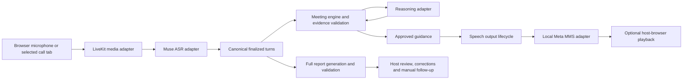

## Streaming speech addition

The integrated backend now supports `TextToSpeech` (`identity`, `stream`, `synthesize`) with a shared `SpeechService` for authenticated access and request accounting. Select `RALLY_SPEECH_ADAPTER=seamless-aws` with the backend secret `RALLY_TTS_TOKEN`; `RALLY_PAID_ENABLED` remains required. Identity declares the requested model and PCM format; remote checkpoint revision is unknown. See [implementation/configuration/evidence](streaming-speech-plan.md). The earlier MMS interface below remains available for explicitly selected local speech. AWS cost records are separate from the Muse grant and keep unknown infrastructure cost explicit.

# Model interfaces and configuration

This page describes the integrated Node app in `apps/rally-api/` and `apps/rally-web/`. Muse Voice Transcribe supplies its canonical transcript. Teams, Zoom and WhatsApp capture surfaces do not supply native platform transcripts. Changing a model does not require changing the meeting UI when the replacement satisfies the same capability interface.

Browser playback does not establish remote-call audibility. The separate Teams guest runner remains a bounded transcription experiment; the WhatsApp guest prototype is not an enabled production invite connector.

## Capability interfaces

[contracts.ts](../apps/rally-api/src/contracts.ts) defines `Providers`, `ASRSession` and `Media`. [speech.ts](../apps/rally-api/src/speech.ts) defines `SpeechEngine`. `createApplication({providers, media, speechEngine})` accepts injected implementations; provider overrides may replace individual capabilities. The default factories are Muse, LiveKit and optional local MMS. Offline tests use the same interfaces.

| Interface | Operations | Contract |
| --- | --- | --- |
| `Providers` | `prepare(meeting)`, `assess(snapshot)`, `report(snapshot)`, `openASR(meeting, callbacks)` | Return normalized plans, assessments, reports and transcription sessions. Provider wire formats stay in adapters. |
| `ASRSession` | `send(bytes)`, `end()`, `close()`; session ID, sent seconds and processed position | Accept mono PCM16 at 16 kHz; preserve pacing, bound buffering, drain final results and release resources. |
| `Media` | `open(meeting, onAudio, onGap)` | Return connection credentials, event delivery and close operations; deliver normalized audio to the engine. |
| `SpeechEngine` | `start()`, `synthesize(text, {signal})`, `close()`; optional identity | Return bounded PCM/WAV, duration, sample rate and actual model/revision; honor cancellation. |

The engine owns moderation pause, evidence validation, capture ownership, session handoff, cooldowns and report lifecycle. Speech output owns approved prompt IDs/epochs, job expiry, playback coverage records and stale-result rejection. Adapters do not decide those policies. The browser never parses raw Muse events.

## Transcription events

| Event | Normalized fields | Meaning |
| --- | --- | --- |
| `partial` | `text`, optional `sessionId` and `turnId` | Transient caption, never evidence. A scoped caption is cleared by its matching final rather than a delayed final for another turn. Legacy unscoped adapters retain clear-on-final behavior. |
| `final` | `sessionId`, `turnId`, `text`, nullable `speaker`; optional `sourceOrder`, `startMs`, `endMs` | Canonical source turn or revision. IDs are opaque; source event order, when known, determines chronology. Unknown speaker/timing remains unknown. |
| `progress` | `processedMs` | Provider-reported processing position; not a precise acoustic timestamp. |

Muse speaker labels follow preceding spans in event order. They are session-local anonymous labels, not meeting roster names or verified human identities. Conflicting or unsupported association remains unknown. A room microphone can contain several people, and a voice can receive more than one label. See [speaker attribution](speaker-attribution.md).

`onError` and `onClose` signal failure or closure. The engine drains and replaces sessions according to [handoff policy](asr-session-handoff.md). A different provider must meet that lifecycle contract; a configuration change alone cannot translate a different wire protocol.

## Runtime configuration

Set server-side `RALLY_MODEL_CONFIG` to JSON. The Node parser is `modelSettings()` in [muse.ts](../apps/rally-api/src/muse.ts); speech validation is in [speech-config.ts](../apps/rally-api/src/speech-config.ts). [models.example.json](../config/models.example.json) is an explicit example, not a complete dump of runtime defaults.

| Capability | Supported adapter | Configuration |
| --- | --- | --- |
| Reasoning | `meta-chat-json` | `model`, `reasoningEffort`, `maxOutputTokens`, and `rates` with `input`, `cachedInput`, `output`. |
| Transcription | `meta-realtime-asr` | `model`, `usdPerAudioHour`. |
| Report | Uses selected reasoning model | Separate `reasoningEffort` and `maxOutputTokens` under `report`. |
| Speech | `mms-local` | `facebook/mms-tts-*` model, its own pinned 40-character revision and 16000 Hz sample rate. |

Compatible models can be selected through configuration. A changed reasoning/transcription model requires explicit prices; these are operator configuration, not a live price lookup. Unsupported adapters, malformed rates and incompatible speech formats fail validation. The current reasoning adapter also restricts model identifiers to supported Muse naming and disallows contributor data-sharing mode.

Preparation currently uses its own low-effort/4096-token policy. Live assessment uses `reasoning` settings; final analysis uses `report` settings. Do not assume the live token limit controls every operation.

Enable local speech separately with `RALLY_MMS_ENABLED=1`, plus the configured Python environment and model directory. Provision the pinned weights explicitly: inference does not download them. A changed speech model requires its own revision, matching local manifest/checksums and a validated compatible waveform. English is the checkpoint actually tested here. Configuration acceptance is not evidence that another language/model works. See [integrated speech](integrated-speech.md).

## Replacing an adapter

Implement the capability interface and inject it at application construction. If production selection should use a new adapter name, extend configuration validation and the corresponding factory together. Keep protocol parsing, pacing and provider accounting inside that adapter; preserve the normalized schemas and engine lifecycle.

A replacement reasoning adapter must return the existing plan/assessment/report schemas and preserve evidence IDs. A replacement ASR adapter must establish its own sessions, handle bounded audio and final drain, normalize uncertain speaker/timing metadata and report failure. A replacement speech adapter must report actual provenance, honor aborts and produce the supported bounded audio format or convert it internally.

Paid adapters must reserve and reconcile usage through the accounting path before use. Current Muse requests record the selected model, adapter and rate table. Unknown costs block further paid work; failed calls are not automatically retried. Local MMS has no speech-provider API charge. An API-billed speech replacement needs explicit accounting support rather than inheriting that zero-call assumption.

Run adapter tests, lifecycle tests, both type checks and the browser workflow after changing a capability. Keep live-provider verification explicit and reconcile actual usage before repetition. Synthetic model IDs in tests do not establish provider availability or hackathon eligibility.

## Historical Sites implementation

The older `apps/rally/` release has a separate JavaScript adapter registry in [model-services.js](../apps/rally/src/model-services.js) and configuration in [models.js](../apps/rally/src/models.js). It uses proposal/host-confirmation semantics and Sites runtime bindings. Those function signatures and deployment steps do not describe the integrated Node app. Its Teams queue and MMS bridge remain documented separately in [Teams integration research](research/teams-transcription-poc.md) and [MMS playback](mms-playback.md).

## Living-presence integration

The production `checkLive` contract adds nullable `affect`, `focus` and bounded `concerns` to the existing judgment, preserving the configured Spark1.3/minimal model, 2,048-token live allowance (raised after observed truncated outputs), deadlines and accounting path. Stable reference material precedes the complete live snapshot for automatic prefix caching; provider-reported cached usage receives the configured discount. Forecasts and admission share exact request sizing, and final-report reserves include the current complete canonical transcript. Affect is signed continuous actuation with exact supplied evidence, never a mapping from feeling enums. Browser/Teams scenes consume accepted state; current streaming speech remains canonical. See [implementation and measured schema checks](living-presence-implementation.md).
