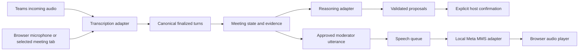

# Model interfaces and configuration

**Integrated Node app:** Muse `Providers` in `apps/rally-api/src/contracts.ts` owns transcription/reasoning; `SpeechEngine` in `src/speech.ts` owns voice generation. `RALLY_MODEL_CONFIG` selects compatible Muse models with explicit changed-model prices. The validated `speech` configuration selects a pinned compatible local MMS checkpoint; enable its runtime separately with `RALLY_MMS_ENABLED`. See [integrated speech](integrated-speech.md) for exact format, provisioning, cancellation and provenance checks. Native platform transcripts are not used. The older Sites configuration and confirmation workflow described below remain specific to `apps/rally/`; the Node report uses reported agreement/proposal/unresolved interpretations.

Rally separates meeting transport, model adapters and application policy. The Teams integration captures incoming meeting audio from the private PulseAudio speaker monitor and streams PCM to **Muse Voice Transcribe**. It does not read Teams captions, native transcription, meeting recap or a platform transcript feed.

Browser capture uses `RallyAudioInput.acquire({mode, includeMicrophone, signal, onEnded})`, returning audio streams and a `close()` handle. Meeting-tab selection is explicit and browser-controlled; platform presets are metadata. The separate `check()` operation meters sources locally and never opens the ASR adapter. Cancellation closes current tracks and any late permission grant.

The diagram describes the implemented boundaries. Connecting generated speech to the Teams virtual microphone remains a separate integration step; browser playback does not establish Teams spoken moderation.

## Configuration

Set the server-side `RALLY_MODEL_CONFIG` environment variable to a JSON object using [the example configuration](../config/models.example.json). Partial capability overrides are supported. Runtime validation and defaults live in [models.js](../apps/rally/src/models.js). The browser sees model/adapter identifiers through `/api/config`, never credentials. Keep the runtime API key in its existing secret binding.

- `reasoning`: adapter ID, model ID, reasoning effort, output-token limit and input/cached-input/output prices per million tokens.
- `transcription`: adapter ID, model ID and audio price per hour.
- `speech`: adapter ID, model ID, pinned checkpoint revision and the bridge's sample rate.

The current adapters are `meta-chat-json`, `meta-realtime-asr` and `mms-local`. Their defaults remain Muse Spark 1.3, Muse Voice Transcribe 1.0 and self-hosted Meta MMS English. A compatible model using the same protocol/schema can be selected in configuration. Another provider protocol needs an adapter implementation and validation registration; configuration does not make an incompatible API or output schema interchangeable.

Changing a reasoning/transcription model requires explicit pricing. Unknown adapters, missing prices for a changed model, invalid prices and unsupported speech formats fail before a provider call. Model availability, rates, protocol compatibility and event eligibility still require verification before changing a production selection.

Hosted configuration is set through Sites runtime environment tooling, followed by deployment. The local preview reads the same JSON variable. The MMS runner reads the root environment and the same capability parser; a model change also requires explicitly downloading the pinned checkpoint to the configured model directory and restarting the idle speech runner. Inference never downloads model weights.

## Transcription port

`openASR(env, callbacks)` returns a session with `send(bytes)`, `end()`, `close()`, `sessionId`, `sentSeconds` and `processedMs`. The current audio contract is mono PCM16 at 16 kHz. Consumers receive provider-independent events:

| Event | Fields | Meaning |
| --- | --- | --- |
| `partial` | `text` | Noncanonical live caption; not outcome evidence |
| `final` | `sessionId`, `turnId`, `text`, `speaker` | Finalized source turn; identity may remain unknown |
| `progress` | `processedMs` | Provider-reported processed duration |

`onError`/`onClose` signal failure or closure. Provider event names are normalized inside the Meta adapter. Browser and Teams consumers do not parse Meta's raw event names. Final drain, cancellation, pacing and unknown-handshake accounting are adapter acceptance requirements.

The Teams backend reserves usage before opening a provider session and returns the selected transcription configuration to the runner. Completion uses the model and pricing stored in that reservation, even if server configuration changes during the call. Browser sessions capture their selected transcription configuration at session construction. Both paths retain actual model identifiers in usage records.

## Reasoning port

`moderate(env, meetingSnapshot, repository, options)` returns `{decision, usage}`. The application validates the decision's structure, cited turn IDs, source revisions and roster owners through the existing domain functions. Valid model output creates proposals; explicit host confirmation is a separate state transition.

[model-services.js](../apps/rally/src/model-services.js) is the adapter registry used by live moderation and retrospective review. Test injection uses the same function signatures. Meeting timers, cooldowns, pause/override and evidence handling remain application behavior.

Usage records include the actual model, adapter and pricing used. Forecasts and final usage calculations use the selected rate table. Retrospective-review fingerprints include model/control settings so a changed model is not mistaken for the previous cached review.

## Speech port

The local speech engine exposes `start()`, `synthesize(text, {signal})` and `close()`. Its normalized output includes the actual model/revision, sample rate, PCM base64 and duration. The current bridge accepts bounded mono PCM16 at 16 kHz; an engine producing a different format must convert it at the adapter boundary.

The queue accepts only an existing current moderator utterance or a fixed diagnostic phrase. It does not accept arbitrary client text. The worker is advertised as ready only after loading and verifying the configured checkpoint. Host cancellation stops local generation and playback; stale meeting epochs are rejected before audio is served. [Playback implementation and operations](mms-playback.md).

## Verification boundary

Configuration selection, canonical event mapping, pricing propagation and session pricing snapshots are covered by offline tests. Changed model IDs in those tests are synthetic identifiers and are not claims of available models. No additional Muse transcription/reasoning request was made for these tests. Live Teams pacing and real-device audio checks remain pending; the currently running Teams queue process must load the changed adapter code at an idle restart before testing it.

New paid-provider adapters must reserve and reconcile usage through the same accounting boundary before production use. The current speech adapter runs MMS locally and makes no billed speech-provider request; adding an API-billed speech adapter requires explicit pricing and accounting support rather than inheriting the local adapter’s zero provider-call cost.

## Separate Node backend MVP

The Node service in `apps/rally-api/` implements the same provider capability boundary with a separate full-report stage and session-scoped diarization. See [AI processing](ai-processing.md) and [API contract](backend-api.md). It does not replace or alter the private Sites Worker. Model changes require an explicit adapter and price configuration; paid calls are disabled by default. The backend output distinguishes reported agreement, proposals and unresolved items; these remain AI interpretations until reviewed by the host.
