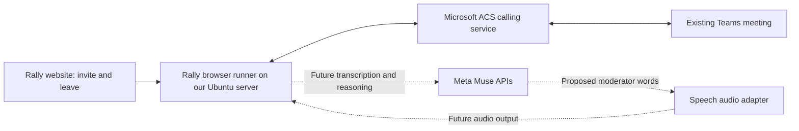

# Rally Teams connection — explanation and administrator brief

Updated October 28, 2026. This explains the selected integration, its alternatives and the actual request to a Microsoft/Azure administrator. Live normal-client transport evidence is linked below; the ACS SDK route is separate.

**Implementation update:** User subsequently requested app registration. Entra client-secret authentication is now implemented in the Linux runner; see [setup and validation](teams-app-registration-setup.md). The discussion below originally described it as a code change still to make; that change is complete, but actual credentials/RBAC/meeting audio are not verified. An ACS resource remains necessary for the implemented ACS runner; it is not a universal requirement for every Teams participant.

**Latest live result:** The normal Teams web client has now joined the supplied meeting from this Ubuntu server, with host-confirmed outgoing speech and measured incoming speech through both the browser stream and virtual speaker. This guest-client path used no ACS resource or custom app registration. It is not yet connected to the full Muse moderation loop or the hosted Invite controls. See [live test evidence](research/teams-web-client-spike.md). The ACS setup below describes the separate SDK alternative.

## Does every meeting participant need ACS?

No. If Rally already has a working Teams client or another integration that joins a meeting and exposes incoming and outgoing audio to the program, that integration supplies the transport and ACS is unnecessary for that workflow. Being a participant describes the outcome; a client or media integration must implement it.

The existing room/browser Rally can capture microphone input and play speech. The server experiment proved local synthetic two-way audio. Those results do not establish that Rally has joined a real Teams meeting or received and sent audio there. The installed runner uses ACS to supply that still-unverified Teams connection. ACS is a transport implementation choice, not the transcription or moderation service.

A regular Teams client with virtual speaker/microphone routing has now passed the transport test on this Ubuntu host. It removes the ACS prerequisite for that route. Full Rally/Muse integration is still pending; use the linked test report to distinguish these evidence levels.

## Why Azure Communication Services was requested

Rally needs two independent capabilities: meeting intelligence and meeting participation. Meta/Muse provides the planned transcription and moderation intelligence. A separate calling connection must make Rally appear in Teams, receive meeting audio and send speech back.

The separate SDK-based route uses **Azure Communication Services (ACS)** as that calling connection. Microsoft documents ACS applications joining Teams as external participants and using audio/video. A bot can use that same interface. It needs an ACS resource and calling user token, and the meeting's anonymous-join/lobby rules apply. [Microsoft Teams interoperability](https://learn.microsoft.com/en-us/azure/communication-services/concepts/join-teams-meeting).

An Azure subscription supplies the billing/account container for the ACS resource; it is not another Teams deployment. An existing suitable organizational subscription is sufficient if its administrator approves this use. The ACS resource needs an active subscription. [Create ACS resource](https://learn.microsoft.com/en-us/azure/communication-services/quickstarts/create-communication-resource).

## What connects to what

Intended architecture:

The website is a remote control. The Ubuntu runner is the actual participant client. ACS connects that client to the existing Teams meeting. Muse is a separate service that will interpret audio; ACS is not being selected as the meeting's AI model. The speech adapter must produce real audio for the Teams stream; existing device speech synthesis cannot simply be copied into it.

For the ACS SDK route in this diagram, Site controls, server runner and local synthetic two-way audio tests work, but no authenticated ACS-backed meeting test has been established. The separate normal Teams client has passed a real two-way meeting-audio test as described above. Neither route is yet connected to the complete Teams-to-Muse moderator loop. The hosted preview still invokes the ACS runner.

## Could an app registration replace it?

An Entra app registration gives software an identity and permissions; it does not by itself supply a call/media engine. There are two relevant uses:

1. **Use an app registration to authenticate to ACS.** A service principal with appropriate Azure RBAC on the ACS resource can authenticate the Identity SDK, which then creates calling tokens. This can replace storing the resource's shared access key/connection string, but **does not remove the ACS resource or subscription**. Microsoft recommends Entra authentication where possible. Our current runner supports service-principal credentials, a connection string, or an explicitly supplied temporary calling token; see [implemented setup](teams-app-registration-setup.md). [Microsoft ACS authentication](https://learn.microsoft.com/en-us/azure/communication-services/concepts/authentication).
2. **Build a native Teams/Graph calling bot.** App registration is part of this different design, alongside bot registration/calling configuration and media permissions. Application-wide calling permissions require administrator consent; Microsoft also documents resource-specific permissions for relevant chats/meetings. Select permissions for the actual implementation, rather than treating a blanket permission list as approved. [Register a calling bot](https://learn.microsoft.com/en-us/microsoftteams/platform/bots/calls-and-meetings/registering-calling-bot).

The native Graph application-hosted raw audio SDK requires C#/.NET and Windows Server, with Windows Server in Azure for production; development/test can use an on-premises Windows Server. Our existing host is Ubuntu. Therefore this is a separate media service/hosting implementation, not a credential swap in the installed Linux browser runner. Avoid assuming app registration alone removes all Azure/hosting requirements. [Native media hosting requirements](https://learn.microsoft.com/en-us/microsoftteams/platform/bots/calls-and-meetings/requirements-considerations-application-hosted-media-bots).

## Request to share with an administrator

> We are building Rally, a hackathon meeting moderator. We want it to join a designated Microsoft Teams work/school test meeting as an explicitly named external participant, receive audio and eventually send synthesized speech back. Our prototype runs a Microsoft ACS browser Calling SDK client on an existing Ubuntu server. Could you provision one Azure Communication Services resource in an approved existing subscription, or identify one we may use, and confirm that our test meeting permits anonymous external joining with host admission? We need approved server-side access to create short-lived VoIP calling tokens. Entra app-registration/service-principal authentication with resource-scoped RBAC is implemented, and a resource connection string remains a supported alternative. This is not a request for organization-wide calendar, email or transcript access. Once the audio-to-Muse integration is enabled, meeting audio will be sent to Meta model APIs for transcription/reasoning; that data flow needs approval for the chosen test content. The initial preview only tests the calling connection, is limited to three minutes, and Azure usage is billed separately from Meta hackathon credits.

This text is a draft for the user to share; no message has been sent to anyone.

## Recommendation and next decision

The normal Teams client with virtual audio is now a proven transport candidate on the current Linux host. Next integrate it with Rally's existing protected controls and Muse moderation loop, then verify end-to-end behavior. Keep the separate ACS SDK route as an alternative; its app-registration support remains implemented. Phone-on-table browser mode remains the fallback, with Teams participation the user's priority.

This is an engineering recommendation, not a proven live Teams capability. [Current integration evidence](research/teams-site-integration.md), [credential setup](teams-setup.md). No new Muse cost.
